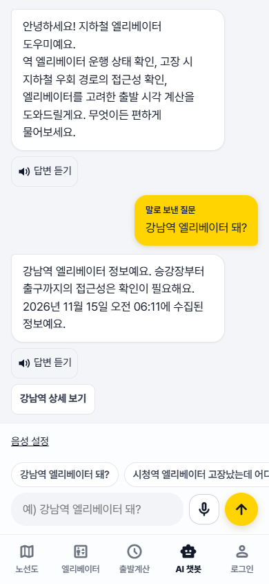
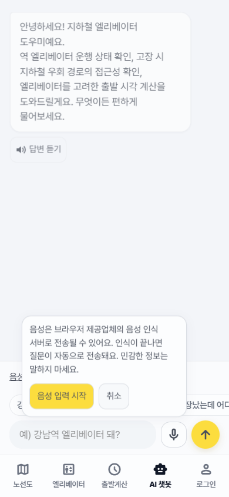

# 챗봇 음성·이동 방면 통합 기록

2026-11-15 사용자 요청에 따라 음성 인식, TTS, 방면 분석을 서로 다른 에이전트에 배정했다. 음성 인식은 `voice/recognition/`, TTS는 `voice/tts/`, 방면 분석은 형제 `AI/` 저장소만 수정하도록 분리했고, 통합 담당자가 `ChatView`·회귀 테스트·공통 문서만 수정했다. 동일 폴더에서 별도 첫 화면/색상 작업이 진행 중이므로 해당 변경은 이 기능 커밋에 포함하지 않는다.

## 사용 동작

챗봇 입력창 옆의 마이크를 누르고 최초 안내에서 **음성 입력 시작**을 선택한다. 듣는 동안 한국어 받아쓰기가 보이며 인식 종료 시 질문이 한 번 자동 전송된다. 멈춤을 누르면 지금까지 받은 문장을 보낸다. 실패하거나 화면을 벗어나 취소하면 전송하지 않고 기존 글자 초안을 보존한다. 말로 보낸 질문에는 출처를 표시한다.

기본값은 음성 질문의 답변만 자동 읽기다. **음성 설정**에서 항상/끄기로 바꿀 수 있고 모든 모드에서 답변의 **답변 듣기**를 수동 사용할 수 있다. 읽는 중에는 멈추기 버튼이 표시되며 새 질문, 마이크 클릭, 앱 탭 이동, 브라우저 숨김에도 읽기가 중단된다. 듣는 동안 읽기 버튼을 숨겨 앱 음성을 마이크가 다시 인식하는 상황을 줄인다. 배경에서 늦게 도착한 답변은 자동 읽지 않는다.

질문 입력에 실제 label을 연결하고, 처리 상태와 새 답변을 `role=status`로 알린다. TTS 자동 읽기 때 live region에는 답변 도착 안내만 두어 같은 답변 전문을 중복 낭독하지 않게 한다. TalkBack이 켜졌는지 앱이 추측하지 않으며 중복되면 자동 듣기를 끌 수 있다. 이 조정만으로 실제 TalkBack 경험이나 WCAG 준수를 보장하지 않는다.

## 방면 판단에서 확인한 내용

기존 AI 대체역 조회는 열차 방면을 검증하지 않았고, 두 역 ID만으로 지도 우회 경로 동작을 만들었다. 이번 AI 변경은 근거 없는 경로 버튼을 후보 역 상세로 바꾸고, 승차 중 문의에는 현재/최근 정차역·호선·다음 정차역·목적지·고장 역·탑승 여부를 확인한다. 이 정보와 실제 설비 상태를 안내하되, 플랫폼·반대편 이동·계단 없는 환승 근거가 없으면 계속 탑승/하차/역방향 환승을 확정 지시하지 않는다.

BE 계약에 실제 열차 방향·승강장 연결 증거가 없어 방향을 고려한 안전한 우회 경로 추천까지 구현된 것은 아니다. 현재 완료 범위는 **문맥 수집, 실제 상태·후보 조회, 방향 판단의 한계 명시, 잘못된 추천 차단**이다. 상세 시나리오와 필요한 BE 필드는 [AI 방면 분석 문서](../../AI/docs/directional-alternatives-analysis.md)를 참고한다. 저장소를 따로 열면 AI 저장소의 같은 경로를 확인한다.

## 자동 검증

인식 13개, 합성 12개, 통합 6개 테스트는 실제 음성 장치나 외부 음성 API를 사용하지 않는다. 통합 테스트는 중간 결과 표시, 중복 종료에도 1회 전송, 음성 출처, 기본/항상/끄기, 수동 듣기·중단, 다른 탭에서 도착한 답변 무음, 권한 거부 후 글자 초안 보존, 경고·수집시각·출구번호 보존, API HTML 무시를 확인한다.

Chrome 검증은 실제 브라우저에 가짜 음성 API만 주입한다. 320/390px와 글자 크기 4단계, 44px 이상 버튼, 가로 넘침 없음, 안내 확인 이전 인식 없음, 자동 읽기·멈춤을 검사하고 `web/artifacts/chat-voice/`에 스크린샷과 결과를 저장한다.

최종 분리 스냅샷에서 React 테스트 67개, 기존 서비스 테스트 85개, 기존 브라우저 테스트 5개와 음성 Chrome 통합 검증을 통과했다. TypeScript/모의 빌드/ESLint도 통과했다. 별도 작업의 첫 화면·출발계산·브랜드 색상 변경은 이 숫자와 스냅샷에 포함하지 않았다. 별도 작업과 섞인 공유 `dist`에서의 중간 검증은 결과에서 제외하고, 임시 인덱스로 만든 독립 소스를 빌드해 다시 검증했다. 임시 소스가 `web/` 아래에 있어 상위 ES module 설정을 상속하지 않도록 검증 폴더 루트에만 CommonJS 경계를 두었으며 제품 소스는 변경하지 않았다.





```powershell
cd FE/web
npm.cmd test
npm.cmd run test:legacy
npm.cmd run lint
npm.cmd run build:mock
node scripts/verify-chat-voice.mjs --legacy
```

기존 브라우저 5개는 별도 첫 화면 개발 중인 환경에서는 저장된 기본 접근성 설정만 주입해 앱 화면을 검증한다. `--legacy`를 생략하면 음성 화면만 검증한다. 테스트에 사용한 가짜 인식/합성은 제품 번들에 포함되지 않는다.

## 안드로이드 크롬 실기기 확인

사용자가 선택한 환경은 Android Chrome이다. 아직 실제 휴대폰에서 녹음·합성·권한 창·TalkBack을 확인하지 않았다. 따라서 REQ-CHAT-004/005는 실기기 확인을 남긴 진행중 상태다. 자동 테스트 성공을 인식 정확도·음질 보장으로 취급하지 않는다.

배포된 HTTPS 주소에서 확인하는 방법을 우선한다. PC의 `http://localhost:5173`은 휴대폰에서는 휴대폰 자신을 가리킨다. 단순 LAN IP의 HTTP 접속은 마이크의 신뢰 가능한 출처 조건을 충족하지 못할 수 있다. [Web Speech 보안·개인정보](https://webaudio.github.io/web-speech-api/#security-and-privacy-considerations), [MDN 지원 한계](https://developer.mozilla.org/en-US/docs/Web/API/SpeechRecognition).

로컬 개발은 USB 디버깅을 허용한 휴대폰을 PC에 연결하고 Android SDK의 adb로 포트를 역방향 연결할 수 있다. 이 PC에는 adb가 설치되어 있으나 확인 시 연결된 기기는 없었다. 실행 중인 서버가 각각 5173/8000/8001을 쓰는 경우:

```powershell
adb devices
adb reverse tcp:5173 tcp:5173
adb reverse tcp:8000 tcp:8000
adb reverse tcp:8001 tcp:8001
```

휴대폰 Chrome에서 `http://localhost:5173`에 접속한다. FE의 BE/AI 기본주소가 localhost 또는 127.0.0.1인지, BE/AI CORS가 FE의 localhost:5173을 허용하는지도 확인해야 한다. 서버 프로세스 실행이나 CORS 변경은 이 문서의 명령만으로 수행되지 않는다. 모바일 Chrome의 USB 포트 전달은 [Chrome 공식 원격 디버깅 안내](https://developer.chrome.com/docs/devtools/remote-debugging/local-server/)를 따른다.

1. 챗봇에서 마이크 → 안내 확인 → Android와 Chrome의 마이크 권한을 허용한다.
2. “강남역 엘리베이터 돼?”라고 말한다. 중간 받아쓰기, 1회 사용자 말풍선, 실제 답변, 한국어 자동 읽기를 확인한다.
3. 듣기 멈춤·읽기 멈춤·탭 이동·홈으로 이동이 작동하는지 확인한다.
4. 글자로 같은 질문을 보내 자동 읽기는 하지 않고 **답변 듣기**를 누르면 읽는지 확인한다. 항상/끄기도 바꿔 본다.
5. 한국어 목소리가 없으면 Android의 TTS/텍스트 음성 변환 설정에서 한국어 음성을 설치하고 브라우저를 다시 연다. 자동 재생 제한 시 답변 듣기로 재생되는지 확인한다.
6. 권한 거부와 무음에서도 글자 입력이 되는지 확인한다. TalkBack과 자동 듣기가 겹치면 끄기를 선택하고 수동 듣기를 사용한다.

확인 결과에는 기기명·Android/Chrome 버전·권한 허용 여부·인식된 문장·자동/수동 읽기 결과를 적는다. 녹음 파일이나 개인정보를 보낼 필요는 없다.
