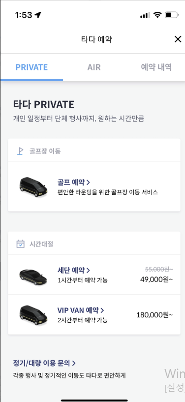

# 엘리베이터 화면

- 영역 코드: `ELV`
- 범위: `#view-elevator` / 관련 파일 `Prototype-v2/js/app.js`(엘리베이터 탭 섹션), `Prototype-v2/js/elevator-service.js`, `Prototype-v2/css/style.css`
- 기준 프로토타입: `Prototype-v2/` (v1 `Prototype/`은 수정하지 않음)
- 스크린샷: [../assets/elevator/](../assets/elevator/)

## 요구사항

### REQ-ELV-001 상단 고정 필터 바로 역 목록 개편

- 상태: 완료
- 우선순위: P1 (제안)
- 등록일: 2026-11-11
- 대상:
  - `Prototype-v2/index.html` `#view-elevator` (`#elevatorSummary`, `#elevatorFilter`, `#elevatorList` 순서)
  - `Prototype-v2/js/app.js` `ELEV_FILTERS`, `elevFilter`, `initElevatorTab`, `renderElevatorSummary`, `renderElevatorList`, `dataStations`
  - `Prototype-v2/css/style.css` `.chip-row`, `.chip`, `.summary-grid`

**현재 문제**
필터 칩(전체 / 이용 불가·점검 / 2호선 / 환승역)이 요약 카드 아래에 있고, 스크롤하면 함께 올라가 사라진다. 호선 필터는 2호선 하나로 고정되어 있어 다른 호선 역만 따로 볼 수 없다.

**요구사항**
1. 화면 구성 순서는 위에서부터 `제목 → 요약 카드 → 필터 바 → 역 목록`이다.
2. 필터 바는 목록을 스크롤해도 화면 상단에 고정되어야 한다. 요약 카드는 스크롤하면 위로 사라진다.
3. 필터 바의 버튼은 `전체역`, `고장·점검`, `환승역`, `호선 ▼` 네 개다.
4. 네 버튼은 한 번에 하나만 선택된다. 다른 버튼을 누르면 이전 선택은 해제된다.
   - 목록에는 엘리베이터 정보가 있는 역만 나온다. 정보가 없는 역은 어떤 필터에서도 나오지 않는다.
   - `전체역`: 1~8호선에서 엘리베이터 정보가 있는 모든 역을 보여준다.
   - `고장·점검`: 이용 불가 또는 점검 중인 엘리베이터가 하나라도 있는 역만 보여준다.
   - `환승역`: 환승역(노선이 2개 이상인 역)만 보여준다.
   - `호선 ▼`: 누르면 1~8호선 목록이 펼쳐지고, 여러 호선을 중복 선택할 수 있다. 선택한 호선 중 하나라도 지나는 역을 보여준다.
5. 호선 목록은 `호선 ▼` 버튼 바로 아래에 작은 드롭다운으로 열린다. 바텀시트는 쓰지 않는다. 바깥을 누르면 닫힌다.
6. 호선 목록의 각 항목에는 노선 색 점을 붙여 노선도와 같은 색으로 구분한다.
7. 호선을 누르는 즉시 목록에 반영한다. `적용` 버튼은 없다. 드롭다운은 열린 채로 남아 이어서 고를 수 있다.
8. 호선을 고르면 버튼 문구에 고른 호선이 보인다.
   - 1개: `2호선 ▼`
   - 2개: `2·4호선 ▼`
   - 3개 이상: `2·4 외 1 ▼` (호선 번호 오름차순으로 앞의 2개 + 나머지 개수)
   - 0개: `호선 ▼`
9. 선택된 호선을 모두 해제하면 자동으로 `전체역`이 선택된다. 아무 필터도 선택되지 않은 상태는 없다.
10. `호선 ▼`이 선택된 상태에서 다른 버튼(`전체역` 등)을 누르면 고른 호선은 모두 해제된다.
11. 요약 카드 숫자는 필터와 관계없이 항상 전체 기준이다.

**결정 사항**
- 2026-11-11 요약 카드는 필터 바 위에 두고, 숫자는 항상 전체 기준. (필터 결과 기준으로 하면 `고장·점검`에서 "정상 역 수"가 늘 0이 되어 어색함)
- 2026-11-11 호선 목록은 바텀시트가 아니라 버튼 아래 드롭다운. → 2026-11-13 REQ-ELV-005에서 필터 아래로 펼치는 칩 두 줄로 바꿈.
- 2026-11-11 호선 선택은 즉시 반영 (`적용` 버튼 없음).
- 2026-11-11 버튼 표시는 고른 호선 이름 (`2·4호선 ▼`, 3개 이상은 `2·4 외 1 ▼`).
- 2026-11-11 호선을 모두 해제하면 `전체역`으로 자동 전환.
- 2026-11-11 호선 범위는 1~8호선 (REQ-MAP-002와 일치). 원문의 "1~9호선"은 사용자가 정정함.
- 2026-11-11 `전체역`을 포함한 모든 필터는 엘리베이터 정보가 있는 역만 대상으로 함.
- 2026-11-11 버튼 이름 `이용불가/점검` → `고장·점검`으로 변경. 글자 크기를 키우면(REQ-DS-004) 375px 폭에서 네 버튼이 넘칠 수 있어 이름을 줄임. 뜻(이용 불가 또는 점검 중인 엘리베이터가 있는 역)은 그대로.

**완료 조건**
- [x] 요약 카드가 필터 바 위에 있다.
- [x] 목록을 스크롤해도 필터 바가 상단에 붙어 있다.
- [x] 어떤 필터에서도 엘리베이터 정보가 없는 역은 나오지 않는다.
- [x] `호선 ▼` 목록에 1~8호선만 있다.
- [x] 필터 바에 `전체역`, `고장·점검`, `환승역`, `호선 ▼` 네 버튼만 있다. (`2호선` 고정 칩 없음)
- [x] 네 버튼 중 하나만 선택된 상태로 표시된다.
- [x] `고장·점검`을 누르면 이용 불가 또는 점검 엘리베이터가 있는 역만 나온다.
- [x] `환승역`을 누르면 환승역만 나온다.
- [x] `호선 ▼`을 누르면 버튼 아래에 드롭다운이 열리고, 바깥을 누르면 닫힌다.
- [x] 호선을 누르는 즉시 목록이 바뀐다. 여러 호선을 고르면 그 호선들의 역이 합쳐서 나온다.
- [x] 버튼 문구가 선택 개수에 따라 `호선 ▼` / `2호선 ▼` / `2·4호선 ▼` / `2·4 외 1 ▼`로 바뀐다.
- [x] 호선을 모두 해제하면 `전체역`이 선택된다.
- [x] 호선 선택 중 다른 버튼을 누르면 고른 호선이 해제된다.
- [x] 필터를 바꿔도 요약 카드 숫자는 변하지 않는다.
- [x] 결과가 없을 때 빈 상태 문구가 나온다.
- [x] 375px 폭에서 네 버튼이 잘리거나 줄바꿈되지 않는다.
- [x] 역을 누르면 지금처럼 역 상세 바텀시트가 열린다.

**참고**
- 사용자 원문: "엘리베이터 탭 위쪽에 바를 하나 만드는거야. 그 바에 전체역, 이용불가/점검, 환승역, 호선(아래세모) 이렇게 해서 각 카테고리를 누를때마다 그 역만 보이는 느낌으로 하고 싶은데"
- 사용자 원문 (선택 방식): "전체역은 1~9호선 다 나오는 거고, 이용불가,점검은 그런 엘베 있는 역만 나오는거고, 환승역은 환승역만 나오는거고, 호선 아래 세모는 1~9호선 중에 중복으로 선택할 수 있게 할거야."
- 요약 카드 위치: 사용자가 "필터바 위에 두는 건 어떻게 생각해?"라고 제안함.
- 세부 동작(카드 숫자 기준, 드롭다운 방식, 즉시 반영, 버튼 표시, 전체 해제 시 동작)은 2026-11-11 논의에서 추천안으로 결정.
- 관련: REQ-MAP-002 (노선 범위), REQ-DS-004 (글자 크기 단계)

**작업 기록**
- 2026-11-13 완료
  - `Prototype-v2/index.html`: `#elevatorFilter`를 `.filter-bar`(`role="toolbar"`)로. 순서는 그대로 제목 → 요약 카드 → 필터 바 → 목록.
  - `Prototype-v2/js/app.js`: `ELEV_FILTERS`를 `전체역` / `고장·점검` / `환승역`으로, `2호선` 고정 칩 삭제. `호선 ▼`(`#elevLineBtn`) + 여러 개 고르는 목록(`#elevLineList`, `aria-multiselectable`, 노선 색 점, 고른 항목은 체크). `elevFilter`(`all` / `problem` / `transfer` / `lines`)와 `elevLines`로 상태 관리: 네 버튼 중 하나만 선택(`aria-pressed`), 호선은 누르는 즉시 반영하고 목록은 열린 채로, 모두 해제하면 `전체역`, 다른 버튼을 누르면 고른 호선 해제. 버튼 문구 `elevLinesLabel`(`호선` / `2호선` / `2·4호선` / `2·4 외 1`). 바깥 누르기·Esc로 목록 닫힘(바깥을 누른 그 한 번은 닫기만, 뒤의 역이 열리지 않게). `고장·점검`은 멈춘 엘리베이터가 하나라도 있는 역. 목록은 `dataStations`(엘리베이터 정보가 있는 역)만.
  - `Prototype-v2/css/style.css`: `.filter-bar`(`position: sticky`, `.view-scroll` 위쪽 여백만큼 올려 맨 위에 붙임, 배경 `--bg`), 네 버튼이 한 줄에 나눠 들어가도록 `flex: 1 1 auto`, 드롭다운을 오른쪽에 맞추는 `.dropdown-menu-end`. 드롭다운 모양은 REQ-MAP-005의 공용 드롭다운.
  - 확인 (375px): 전체역 68곳(정보 없는 역 0), 고장·점검 8곳(모두 멈춘 엘리베이터 있음), 환승역 27곳(모두 노선 2개 이상). 호선 목록 1~8호선 + 색 점. 4 → 7곳 `4호선`, +2 → 48곳 `2·4호선`, +7 → 52곳 `2·4 외 1`, 모두 고른 호선의 역. 모두 해제 → `전체역`. 호선 고른 뒤 `전체역` → 호선 해제. 요약 카드는 계속 60/8/0. 스크롤해도 필터 바가 맨 위(틈 없음), 요약 카드는 위로 사라짐. 네 버튼 한 줄(글자 125%에서도). 역을 누르면 역 상세 시트. 콘솔 오류 없음.
  - 빈 상태 문구: `고장·점검` → "지금은 고장·점검 중인 엘리베이터가 없어요", 그 밖 → "표시할 역이 없어요".


### REQ-ELV-002 요약 카드 높이 어긋남 고치기와 이름 정리

- 상태: 완료
- 우선순위: P0 (제안: 눈에 띄게 깨져 보임)
- 등록일: 2026-11-11
- 대상:
  - `Prototype-v2/css/style.css` `.card + .card` (728행), `.summary-grid`, `.summary-card`, `.summary-num`, `.summary-label`
  - `Prototype-v2/js/app.js` `renderElevatorSummary` (658행~: 카드 이름 `'정상 역 수'`, `'일부 불가'`, `'이용 불가'`, 인라인 `style="font-size:28px…"`)

**현재 문제**
- 요약 카드 세 장 중 두 번째, 세 번째 카드가 12px 아래로 밀려 높이가 어긋나 보인다. 카드를 세로로 쌓을 때 쓰는 여백 규칙(`.card + .card { margin-top: 12px }`)이 가로로 놓인 요약 카드에도 걸리기 때문이다.
- 카드 이름이 `정상 역 수` / `일부 불가` / `이용 불가`로 형식이 제각각이다.
- 숫자 크기와 색이 JS 인라인 스타일로 직접 지정되어 있다.

**요구사항**
1. 요약 카드 세 장은 위아래 위치와 높이가 같아야 한다. `.card + .card` 여백이 요약 카드에 걸리지 않게 한다.
2. 카드 이름은 REQ-DS-008의 상태 이름을 쓴다: `정상` / `일부 운행` / `이용 불가`.
3. 숫자 뒤에 단위 `역`을 붙인다. (예: `60역`) 단위는 숫자보다 작게 쓴다.
4. 숫자 크기는 `--fs-display`(REQ-DS-004), 색은 상태 토큰을 CSS 클래스로 쓴다. JS 인라인 스타일은 없앤다.
5. 카드는 보여 주기만 하고 누를 수 없다. (필터는 REQ-ELV-001 필터 바가 맡는다)
6. 카드 숫자는 지금처럼 필터와 상관없이 전체 기준이다. (REQ-ELV-001 요구사항 11)

**완료 조건**
- [x] 요약 카드 세 장의 위쪽 선과 높이가 같다.
- [x] 카드 이름이 `정상` / `일부 운행` / `이용 불가`다.
- [x] 숫자 뒤에 작은 `역` 단위가 붙는다.
- [x] `renderElevatorSummary`에 인라인 `style`이 없다.
- [x] 카드를 눌러도 아무 일도 일어나지 않고, 누를 수 있어 보이는 효과(눌림, 커서)가 없다.
- [x] 375px 폭, 글자 크기 `아주 크게`(REQ-COM-001)에서 숫자와 이름이 잘리지 않는다.

**참고**
- 2026-11-11 추천안으로 결정. ("1. 고치자.")
- 관련: REQ-ELV-001, REQ-DS-004, REQ-DS-008

**작업 기록**
- 2026-11-11 완료
  - `Prototype-v2/js/app.js` `renderElevatorSummary`: 카드에서 `card` 클래스를 빼서 `.card + .card` 여백이 걸리지 않게 함. 카드 이름을 `정상` / `일부 운행` / `이용 불가`로 바꿈. 숫자 뒤에 `<span class="summary-unit">역</span>` 추가. 인라인 `style` 삭제.
  - `Prototype-v2/css/style.css`
    - `:root`에 REQ-DS-004에서 정한 글자 크기 토큰 7개(`--fs-caption`~`--fs-hero`)와 굵기 토큰 3개(`--fw-regular`, `--fw-strong`, `--fw-bold`)를 먼저 추가. 다른 화면 적용은 REQ-DS-004에서 한다.
    - `.summary-num`: `--fs-display`, `--fw-bold`. `.summary-unit` 추가(`--fs-label`). `.summary-label`: `--fs-label`, `--fw-strong`. 색은 기존 `.summary-card.ok/.warn/.bad` 클래스(상태 토큰)를 그대로 씀.
    - 누를 수 있어 보이는 효과 제거: `button.summary-card:active`, `.summary-card`의 `transition` 삭제.
  - 확인: 375px 폭, 글자 크기 100%와 125%(`html` 글자 크기로 `아주 크게` 대신 확인)에서 세 카드의 위쪽 선과 높이가 같고 숫자·이름이 잘리지 않음. 카드를 눌러도 목록이 바뀌지 않음. 콘솔 오류 없음.

### REQ-ELV-003 엘리베이터 정보 기준 시각을 작게 표시

- 상태: 완료
- 우선순위: P2 (제안)
- 등록일: 2026-11-11
- 대상: `Prototype-v2/index.html` `#view-elevator` `.view-title` 아래 / `Prototype-v2/js/app.js` `renderElevatorTab`, `renderElevatorSummary`

**현재 문제**
엘리베이터 상태가 언제 기준인지 화면 어디에도 없다. 상태는 수시로 바뀌기 때문에 사용자가 정보를 믿고 이동하려면 언제 확인된 정보인지 알아야 한다.

**요구사항**
1. 제목 `엘리베이터 현황` 아래(또는 제목 줄 오른쪽)에 `오후 6:52 기준`처럼 기준 시각을 보여 준다.
2. 눈에 크게 띄지 않게 한다: `--fs-caption`(13px), 보조 글자색(`--muted`), 보통 굵기. 아이콘이나 배경은 붙이지 않는다.
3. 목업에는 갱신 시각 데이터가 없으므로, 앱을 연 시각을 기준 시각으로 쓴다. 시연 제어판으로 상태를 바꾸면 그 시각으로 갱신한다.
4. 시각 형식은 REQ-DS-009를 따른다. (예: `오후 6:52 기준`)

**완료 조건**
- [x] 제목 근처에 `오후 6:52 기준`처럼 기준 시각이 13px 보조 글자색으로 보인다.
- [x] 요약 카드나 필터 바보다 눈에 덜 띈다.
- [x] 시연 제어판으로 엘리베이터 상태를 바꾸면 기준 시각이 그 시각으로 바뀐다.

**참고**
- 2026-11-11 결정. 사용자 원문: "좋아. 눈에 크게 띄지는 않게 하자."
- 2026-11-11 시각 형식을 24시간제에서 오전/오후 형식으로 변경 (REQ-DS-009 결정에 맞춤).
- 관련: REQ-COM-003 (시연 제어판 상태 조작)

**작업 기록**
- 2026-11-13 완료
  - `Prototype-v2/index.html`: 제목 줄을 `.elev-title-row`로 감싸고 오른쪽에 `#elevUpdated`.
  - `Prototype-v2/js/app.js`: `elevUpdatedAt`(앱을 연 시각), `renderElevUpdated`(`showTime(nowHHMM(...))` + ` 기준`, REQ-DS-009 형식). 엘리베이터 상태가 바뀌면(`ElevatorService.subscribe`) 그 시각으로 갱신.
  - `Prototype-v2/css/style.css`: `.elev-title-row`(제목과 기준 시각을 한 줄, 글자 아래선 맞춤), `.elev-updated`(`--fs-caption`, `--muted`, `--fw-regular`, 아이콘·배경 없음).
  - 확인: 시계를 18:52로 고정해 열면 제목 줄 오른쪽에 `오후 6:52 기준`(13px, #6B7280, 400). 7분 뒤 잠실역을 고장 내면 `오후 6:59 기준`. 글자 125%에서도 제목과 한 줄. 콘솔 오류 없음.


### REQ-ELV-004 역 목록 한 줄을 "운행 대수 + 멈춘 위치"로 정리

- 상태: 완료
- 우선순위: P1 (제안)
- 등록일: 2026-11-11
- 대상:
  - `Prototype-v2/js/app.js` `renderElevatorList` (677행~: `meta` 문구, `statusPill(x.status)`, `.chevron`), `dataStations` (646행)
  - `Prototype-v2/css/style.css` `.station-row`, `.station-row .status-pill`, `.station-row .chevron`

**현재 문제**
역 목록 한 줄에 `이용 불가 1 / 전체 4대` 문구와 `일부 이용 불가` 뱃지가 같은 내용을 두 번 말한다. 정작 어느 엘리베이터가 멈췄는지는 역을 눌러야 알 수 있다.

**요구사항**
1. 역 한 줄은 다음 모양이어야 한다.
   ```
   고속터미널역 ③⑦                 (!) 3/4대  ›
   멈춤: 8-1번 출구 (경부선 터미널)
   ```
2. 첫 줄 왼쪽: 역 이름 + 노선 뱃지 (지금과 같음)
3. 첫 줄 오른쪽: 상태 아이콘(REQ-DS-003) + `운행 대수/전체 대수` + `대`, 그리고 `›`. 상태 뱃지(`status-pill`)는 없앤다.
4. 둘째 줄: 멈춘 엘리베이터(이용 불가, 점검)의 위치(`location`)를 `멈춤: ` 뒤에 보여 준다.
   - 1대: `멈춤: 8-1번 출구 (경부선 터미널)`
   - 2대 이상: `멈춤: 8-1번 출구 외 1곳` (데이터 순서의 첫 위치 + 나머지 개수)
   - 한 줄을 넘으면 말줄임(…)으로 자른다.
5. 정상 역은 둘째 줄 없이 한 줄로 끝낸다.
6. 정렬은 지금처럼 이용 불가 → 일부 운행 → 정상, 같은 상태끼리는 가나다순이다.
7. 화면 읽기 프로그램에는 "고속터미널역, 3, 7호선, 엘리베이터 4대 중 3대 운행, 멈춤 8-1번 출구"처럼 한 번에 읽힌다.

**완료 조건**
- [x] 역 목록에 상태 뱃지가 없고, 오른쪽에 상태 아이콘과 `n/m대`가 있다.
- [x] 멈춘 엘리베이터가 있는 역은 둘째 줄에 위치가 나온다. 2대 이상이면 `외 n곳`으로 줄어든다.
- [x] 정상 역은 한 줄이다.
- [x] 375px 폭, 글자 크기 `아주 크게`에서 긴 역 이름(예: 동대문역사문화공원역)과 위치가 겹치지 않는다.
- [x] 정렬 순서가 바뀌기 전과 같다.
- [x] 역을 누르면 지금처럼 역 상세 바텀시트가 열린다.

**참고**
- 2026-11-11 추천안으로 결정. ("3. 추천 좋다.")
- 역 상세의 운행 현황(REQ-COM-007)과 같은 말투(`n/m대`)로 맞춘다.
- 관련: REQ-ELV-001, REQ-COM-007, REQ-DS-003, REQ-DS-008

**작업 기록**
- 2026-11-13 완료
  - `Prototype-v2/js/app.js` `renderElevatorList`: 상태 뱃지와 "이용 불가 n / 전체 m대" 문구를 없애고, 첫 줄 오른쪽에 상태 아이콘(`getStatusIcon`) + `운행/전체대`, 둘째 줄에 `멈춤: 위치`(멈춘 엘리베이터 데이터 순서의 첫 위치, 2대 이상이면 `외 n곳`). 정상 역은 둘째 줄 없음. 줄 전체에 화면 읽기용 `aria-label`("고속터미널역, 3, 7호선, 엘리베이터 4대 중 3대 운행, 멈춤 7호선 환승통로"), 안쪽 그림은 `aria-hidden`. 정렬은 그대로.
  - `Prototype-v2/css/style.css`: `.station-row.elev-row`(그리드: 이름 | 운행 대수 | ›, 둘째 줄은 앞 두 칸), `.elev-row-op`(아이콘 상태색, 운행 대수 굵게), `.elev-row-stop`(한 줄 말줄임).
  - 확인 (375px): 모든 줄에 상태 뱃지 없음. 잠실(전체 고장) `0/5대` + `멈춤: 2번 출구 (롯데월드몰) 외 4곳`, 시청(2대 멈춤) `3/5대` + `멈춤: 4번 출구 외 1곳`, 정상 역은 한 줄. 정렬(이용 불가 → 일부 운행 → 정상, 가나다) 그대로. 글자 125%에서 동대문역사문화공원역(노선 3개)도 숫자와 겹치지 않음(노선 뱃지가 아랫줄로). 역을 누르면 역 상세 시트. 콘솔 오류 없음.
  - 남은 것: 글자 크기 `아주 크게`는 설정 화면(REQ-COM-001)이 아직 없어 125%로 확인함.

### REQ-ELV-005 호선 고르기를 드롭다운 대신 필터 아래 칩 두 줄로 펼치기

- 상태: 완료
- 우선순위: P1 (제안)
- 등록일: 2026-11-13
- 대상: `Prototype-v2/js/app.js` `initElevatorTab`, `elevLinePanelHtml`, `setElevLinePanel`, `renderElevatorFilter` / `Prototype-v2/css/style.css` `.line-panel`, `.line-chip`

**현재 문제**
`호선 ▼`을 누르면 열리는 드롭다운(8개 × 44px)이 목록 위에 떠서, 목록 윗부분(대개 문제 있는 역)의 엘리베이터 현황을 가린다. 호선을 고르면 목록이 바로 바뀌는데 바뀐 결과가 드롭다운에 가려 보이지 않는다.

**요구사항**
1. `호선 ▼`을 누르면 필터 바로 아래에 1~8호선 칩이 4개씩 두 줄로 펼쳐진다. 목록 위에 겹치지 않고, 목록을 아래로 밀어낸다.
2. 칩에는 노선 색 점을 붙이고, 고른 칩은 노랑 면 + 차콜 글자로 보인다. 칩마다 누르는 영역 44px 이상.
3. 여러 호선 선택, 누르는 즉시 반영, 버튼 문구(`2·4호선` 등), 모두 해제하면 `전체역`, 다른 필터를 누르면 호선 해제는 REQ-ELV-001 그대로.
4. `호선 ▲`을 다시 누르거나 다른 필터를 누르면 칩 줄이 접힌다.

**완료 조건**
- [x] 호선 칩을 펼쳐도 목록·요약 카드가 가려지지 않고 아래로 밀린다.
- [x] 1~8호선 칩이 4개씩 두 줄, 칩 높이 44px.
- [x] 칩을 누르는 즉시 목록이 바뀌고, 고른 칩이 노랑으로 보인다.
- [x] `호선 ▲`이나 다른 필터를 누르면 접힌다.

**참고**
- 사용자 지적 (2026-11-13): "호선 화살표 누르면 호선 체크할 수 있는 거 나오잖아. 근데 그 선택 칸 때문에 지금 위쪽 역들은 엘레베이터 현황이 딱 가려져" → 세 안(아래로 펼치는 칩 두 줄 / 드롭다운 2열 / 가로로 미는 칩 한 줄) 중 "1안으로 해줘".
- REQ-ELV-001의 "호선 목록은 버튼 아래 작은 드롭다운" 결정을 이 요구사항으로 바꿈.
- 관련: REQ-ELV-001, REQ-ELV-006, REQ-DS-006

**작업 기록**
- 2026-11-13 완료
  - `Prototype-v2/js/app.js`: 드롭다운(`#elevLineMenu`, `#elevLineList`, 바깥 누르기 닫기)을 지우고 `#elevLinePanel`(`role="group"`, 칩 `aria-pressed`)로 바꿈. `#elevLineBtn`은 `aria-expanded`로 펼침 상태를 알림.
  - `Prototype-v2/css/style.css`: `.line-panel`(4열 그리드, 위 경계선), `.line-chip`(44px, `--radius-sm`, 고르면 `--primary` 면). 쓰지 않게 된 공용 드롭다운 스타일(`.dropdown*`) 삭제, `.line-dot`은 남김.
  - 확인 (375px): 펼치면 칩 두 줄(높이 44px)이 필터 아래에 생기고 요약 카드·목록이 그만큼 내려감. 2·4·7호선 → 52곳, 문구 `2·4 외 1`. `호선 ▲` → 접힘, `고장·점검` → 호선 해제 + 접힘. 3호선 켰다 끄면 `전체역`. 글자 125%에서 칩 글자 잘림 없음. 콘솔 오류 없음.

### REQ-ELV-006 필터를 밑줄 탭 모양으로

- 상태: 완료
- 우선순위: P2 (제안)
- 등록일: 2026-11-13
- 대상: `Prototype-v2/js/app.js` `initElevatorTab`, `renderElevatorFilter` / `Prototype-v2/css/style.css` `.filter-tabs`, `.filter-tab`

**현재 문제**
필터(`전체역` / `고장·점검` / `환승역` / `호선 ▼`)가 알약 모양 칩이라 사용자가 마음에 들어 하지 않는다.

**요구사항**
1. 필터를 첨부 화면 상단 탭(PRIVATE / AIR / 예약 내역)처럼 네 칸을 똑같이 나눈 밑줄 탭으로 바꾼다.
2. 고른 칸은 진한 굵은 글자 + 아래 굵은 밑줄, 나머지는 회색 글자. 탭 아래에 얇은 경계선.
3. 밑줄 색은 차콜(`--on-primary`). 흰 바탕 위 노랑 얇은 선은 쓰지 않는다(노랑 사용 규칙).
4. 칸 높이는 48px(`--tap-main`). 목록을 스크롤해도 위에 붙어 있는 동작(REQ-ELV-001)은 그대로.

**완료 조건**
- [x] 네 칸이 같은 폭이고, 고른 칸만 진한 글자 + 밑줄이다.
- [x] 칸 높이 48px, 375px·글자 125%에서 글자가 잘리지 않는다.
- [x] 스크롤해도 탭이 맨 위에 붙어 있다.

**참고**
- 사용자 지적 (2026-11-13): "전체역, 고장점검, 환승역, 호선 카테고리 디자인이 조금 마음에 안 들어. 지금 첨부한 것 처럼 네모로 바꿔줘" → 밑줄 탭과 네모 버튼 중 "밑줄 탭 (첨부 상단 탭처럼)".
- 참고 화면: 
- 관련: REQ-ELV-001, REQ-ELV-007, REQ-DS-001

**작업 기록**
- 2026-11-13 완료
  - `Prototype-v2/js/app.js`: 필터 버튼을 `.filter-tab`(네 칸, `aria-pressed`)으로. 호선 칸은 `.tab-label` + 화살표 아이콘(펼치면 위로 돌아감).
  - `Prototype-v2/css/style.css`: `.filter-tabs`(흰 바탕, 아래 경계선, sticky), `.filter-tab`(48px, 회색 글자), `.filter-tab.active`(진한 굵은 글자 + `::after` 3px 차콜 밑줄). 옛 `.filter-bar` 삭제.
  - 확인: 탭 높이 48px 네 칸, 글자 넘침 없음(125% 포함), 스크롤 시 맨 위에 붙음.

### REQ-ELV-007 엘리베이터 탭 위쪽(제목 + 요약 카드 + 필터)을 흰 영역으로

- 상태: 완료
- 우선순위: P2 (제안)
- 등록일: 2026-11-13
- 대상: `Prototype-v2/index.html` `#view-elevator` / `Prototype-v2/css/style.css` `.elev-head`, `#elevatorSummary`

**현재 문제**
엘리베이터 탭 전체가 회색 바탕이라 제목과 필터가 내용과 구분되지 않는다.

**요구사항**
1. 제목 `엘리베이터 현황`, 요약 카드, 필터 탭을 흰 바탕의 머리 영역으로 묶는다(화면 좌우 끝까지).
2. 순서는 REQ-ELV-001 그대로 `제목 → 요약 카드 → 필터 탭 → 역 목록`이다. 역 목록만 회색 바탕에 둔다.
3. 요약 카드 숫자는 계속 필터와 관계없이 전체 기준이다.

**완료 조건**
- [x] 제목부터 필터 탭까지 회색 틈 없이 하나의 흰 영역이다.
- [x] 요약 카드가 필터 탭 위에 있고, 역 목록은 회색 바탕이다.
- [x] 필터를 바꿔도 요약 카드 숫자는 그대로다.

**참고**
- 사용자 지적 (2026-11-13): "엘레베이터 현황까지 위쪽은 흰색이면 좋겠어" → 흰 영역 범위를 물어 "제목 + 필터까지 흰색" (이때 요약 카드를 필터 아래 회색 영역으로 옮김).
- 사용자 추가 지적 (2026-11-13): "엘레베이터 역 상태 수 나타나는 거 저 카테고리 위로 올려줘" → 요약 카드를 다시 필터 탭 위로 올리고, 흰 영역을 제목 + 요약 카드 + 필터 탭으로 넓힘. 순서는 REQ-ELV-001과 같아짐.
- 관련: REQ-ELV-001, REQ-ELV-006

**작업 기록**
- 2026-11-13 완료
  - `Prototype-v2/index.html`: 제목과 요약 카드를 `.elev-head`로 감쌈. 순서는 제목 → 요약 카드 → 필터 탭 → 목록.
  - `Prototype-v2/css/style.css`: `.elev-head`(`.view-scroll` 여백만큼 위·좌우로 늘린 흰 영역, 아래 `--sp-3`), 제목 아래 `--sp-4`.
  - 확인: 머리 영역 좌우 0~375px 흰색, 제목·요약 카드·탭 사이 회색 틈 없음. 흰 바탕에서도 요약 카드는 테두리·그림자로 구분됨. 요약 카드 60/8/0은 필터를 바꿔도 그대로. 스크롤하면 제목·요약 카드는 위로 사라지고 탭만 맨 위에 붙음.


### REQ-ELV-008 디자인 필터에 커스텀 노선과 가로 스크롤 통합

- 상태: 완료
- 우선순위: P1
- 등록일: 2026-11-15
- 관련: #66, #55
- 대상: Prototype-v2/js/app.js, css/style.css (접근성은 accessible-routes/view/expiry, ai-agent.js, elevator-service.js 포함)

기본 밑줄 탭·호선 칩 패널을 보존한다. 로그인 중 커스텀 노선 필터는 오른쪽 고정 추가 버튼과 가로 스크롤/끝 흐림을 제공한다. 기본 필터 조건과 커스텀 조건을 함께 적용한다.

**완료 조건**
- [x] 실제 Chromium 375px 네 글자 크기·키보드·관련 데이터 검증
- [x] #43 기본 상태/필터/디자인과 기존 기능 회귀 없음

**작업 기록**
- 기존 브랜치 ELV005/006/007은 #43에서 이미 다른 뜻으로 사용되므로 본 새 ID008/009/010으로 이관했다. 실제 경로 API는 미연동이다.


### REQ-ELV-009 요약 카드 아이콘·이름·숫자 중앙 정렬

- 상태: 완료
- 우선순위: P1
- 등록일: 2026-11-15
- 관련: #66, #57
- 대상: Prototype-v2/js/app.js, css/style.css (접근성은 accessible-routes/view/expiry, ai-agent.js, elevator-service.js 포함)

기존 상태 아이콘·이름·실제 역 집계를 유지하며 아이콘→이름→숫자를 세로 중앙 정렬한다.

**완료 조건**
- [x] 실제 Chromium 375px 네 글자 크기·키보드·관련 데이터 검증
- [x] #43 기본 상태/필터/디자인과 기존 기능 회귀 없음

**작업 기록**
- 기존 브랜치 ELV005/006/007은 #43에서 이미 다른 뜻으로 사용되므로 본 새 ID008/009/010으로 이관했다. 실제 경로 API는 미연동이다.


### REQ-ELV-010 접근성 검증 기반 지하철 우회 안내

- 상태: 완료
- 우선순위: P1
- 등록일: 2026-11-15
- 관련: #66, #63
- 대상: Prototype-v2/js/app.js, css/style.css (접근성은 accessible-routes/view/expiry, ai-agent.js, elevator-service.js 포함)

일곱 조건의 신선한 경로 근거·연결·목적지·필수 설비를 통과한 지하철만 우선 추천한다. 정거장 수 제한 없이 제공 시간/환승/거리로 비교한다. 데이터 부족은 확인 필요로 표시하고 안전 경로·도보/버스 지시를 만들어내지 않는다. 표시 중 근거 만료는 회수한다.

**완료 조건**
- [x] 실제 Chromium 375px 네 글자 크기·키보드·관련 데이터 검증
- [x] #43 기본 상태/필터/디자인과 기존 기능 회귀 없음

**작업 기록**
- 기존 브랜치 ELV005/006/007은 #43에서 이미 다른 뜻으로 사용되므로 본 새 ID008/009/010으로 이관했다. 실제 경로 API는 미연동이다.

- #66 재통합 최종 검증: [디자인 보존/검증 기록](../design-reintegration-2026-11-15.md). 실제 경로 API 미연동 한계는 그대로다.
